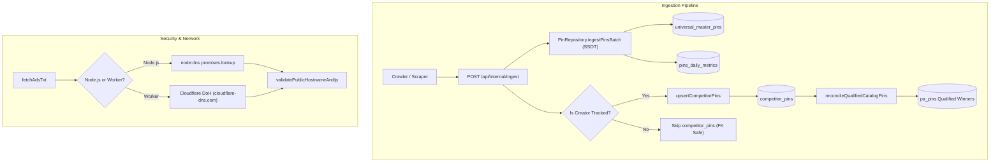

# خطة التنفيذ المعمارية: إصلاح PinRepository، حسم مسار Ingest، تنظيف الاختبارات، وتوحيد قواعد البيانات (SARGable LOWER)

## نظرة عامة والهدف المعماري
تهدف هذه الخطة إلى حل 6 محاور محددة بدقة في محرك `pin-arbitrage-engine`:
1. **ترقية `PinRepository.ingestPinsBatch`**:
   - دعم `options.accountUsername || options.creator` كقيمة احتياطية لـ `creator_username` عند غيابه من بيانات الـ pin الفردية.
   - تطوير `dedupMap` ليقوم بدمج الحقول الفارغة (Merge Empty Fields) واستخدام `Math.max` للمقاييس الرقمية (مع معالجة آمنة لـ `null` للـ pins غير المكتملة `unhydrated`) بدلاً من إسقاط النسخ اللاحقة.
   - تنظيف `dominant_color` الفارغ أو المحتوي على مسافات بيضاء فقط ليتحول إلى `null` بدلاً من سلاسل فارغة.
2. **حسم مصير `competitor_pins` في `/api/internal/ingest`**:
   - توثيق العلاقة المعمارية بين الجدول المركزي الشامل (`universal_master_pins`) وجدول المخزون التنافسي المخصص (`competitor_pins`).
   - تعبئة `competitor_pins` عبر استدعاء `upsertCompetitorPins(sql, competitorId, items)` عندما يكون الحساب مراقباً في `competitor_profiles` قبل تشغيل `reconcileQualifiedCatalogPins`، مع احترام قيد المفتاح الأجنبي `FOREIGN KEY (competitor_id) REFERENCES competitor_profiles(id)`.
3. **معالجة `scripts/test_jit_warming_and_d1_trajectory.mjs` وتأمين `npm test`**:
   - تحديث القسم 4 للتحقق من أن `/api/fleet/warm` تم تقليمه (Pruned) ويعيد 404 (تماشياً مع `src/routes/fleet.mjs` والنمط المعماري الموحد `unified_postgres`).
   - معالجة التناقضات الطفيفة في `scripts/test_fleet_and_routing_hardening.mjs` و `scripts/test_phase2_read_acceleration.mjs` لضمان نجاح `npm test` بالكامل.
4. **مواءمة واجهة إعدادات الكوكي (`/api/settings/cookie`)**:
   - إصلاح `src/ui/dashboard/dashboard-client-app.mjs:2834` لاستخدام `(window.safeApiFetch || fetch)`.
   - تنظيف كائن `cookieStatus` وواجهة المستخدم في `src/ui/dashboard-modals.mjs` لإزالة الاعتماد على حقل `preview` المحذوف أمنياً.
5. **توافقية Cloudflare Workers لخدمة الشبكات الإعلانية (`ad-network-service.mjs`)**:
   - عزل استيراد `node:dns` والاعتماد على استيراد ديناميكي آمن في بيئة Node.js.
   - توفير آلية بديلة كاملة عبر DoH (DNS over HTTPS via Cloudflare: `https://cloudflare-dns.com/dns-query`) لفحص عناوين IP ومنع هجمات SSRF داخل بيئة Cloudflare Workers.
   - توفير فحص بديل لـ `net.isIP` في حال غياب مكتبة `node:net`.
6. **تنظيف الاختبارات والالتزام بالنظافة المعمارية (SARGable Username & Regression Locks)**:
   - حذف `scripts/verify_regression_locks.mjs` نظراً لاستبداله بالكامل بـ AST Parsers والاختبارات الحقيقية (`verify_all_syntax.mjs`، `verify_sql_schema_parity.mjs`، `test_e2e_master_suite.mjs`).
   - إنشاء Migration رقم `058_competitor_profiles_username_lowercase.sql` لتوحيد قيم `competitor_profiles.username` إلى أحرف صغيرة (`LOWER`) مع فرض قيد التحقق `CHECK (username = LOWER(username))` ومفتاح فريد نظيف.
   - إزالة كافة استدعاءات `LOWER(username)` المغلفة غير المفهرسة من استعلامات SQL في `src/modules/keywords/folders-service.mjs` و `src/routes/creators.mjs` و `src/routes/keywords.mjs` لجعل كافة عمليات البحث SARGable وتستفيد 100% من B-Tree Index Seeks.
   - استبدال الـ assertions الشكلية/المغلوطة في `scripts/test_e2e_master_suite.mjs` (مثل `T1_F07_04` و `T2_F07_05` و `T3_05` و `T3_07`) باختبارات فحص برمجية حقيقية لملفات الكود والخدمات.

---

## مراجعة المستخدم المطلوبة (User Review Required)

> [!IMPORTANT]
> **حسم مصير `competitor_pins`:**
> في معمارية PAE، يعد `universal_master_pins` هو المصدر الوحيد للحقيقة (SSOT) لجميع الـ pins المكتشفة في النظام. ومع ذلك، فإن جدول `competitor_pins` يملك قيد مفتاح أجنبي `competitor_id REFERENCES competitor_profiles(id) ON DELETE CASCADE`.
> لذلك:
> عند وصول دفعة إلى `POST /api/internal/ingest` تحمل `creator` أو `type: 'competitor_pins'`:
> 1. يتم استدعاء `PinRepository.ingestPinsBatch` دائماً لحفظها في `universal_master_pins` و `pins_daily_metrics`.
> 2. يتم البحث في `competitor_profiles` عن `creator`. إذا وجد (`comp.id`)، يتم استدعاء `upsertCompetitorPins(sql, comp.id, items)` أولاً لملء `competitor_pins`، ثم استدعاء `reconcileQualifiedCatalogPins(sql, comp.id)`. وإذا لم يكن الحساب مسجلاً، يتم الاكتفاء بـ `universal_master_pins` لمنع انتهاك قيد المفتاح الأجنبي.

> [!NOTE]
> **إزالة `verify_regression_locks.mjs`:**
> بناءً على خياركم المذكور في الطلب، سيتم حذف الملف بالكامل، حيث إن معايير الانحدار أصبحت مفحوصة بدقة عبر `verify_all_syntax.mjs` و `verify_sql_schema_parity.mjs` وجناح الاختبارات الشامل `test_e2e_master_suite.mjs`.

---

## التعديلات المقترحة (Proposed Changes)



---

### 1. طبقة تخزين البيانات (`src/modules/pins/repository.mjs`)

#### [MODIFY] `src/modules/pins/repository.mjs`
- في دالة `ingestPinsBatch`:
  - استخراج القيمة الافتراضية للمنشئ:
    ```javascript
    const defaultCreator = String(options.accountUsername || options.creator || '').replace(/^@/, '').trim().toLowerCase();
    ```
  - دعم دمج الحقول في `dedupMap`:
    إذا كان المعرف `pid` موجوداً مسبقاً في الخريطة:
    - المقاييس: استخدام `Math.max` على القيم المعرفة:
      ```javascript
      if (incoming.save_count !== null && incoming.save_count !== undefined) {
        existing.save_count = existing.save_count === null ? incoming.save_count : Math.max(existing.save_count, incoming.save_count);
      }
      existing.repin_count = Math.max(existing.repin_count || 0, incoming.repin_count || 0);
      existing.comment_count = Math.max(existing.comment_count || 0, incoming.comment_count || 0);
      existing.share_count = Math.max(existing.share_count || 0, incoming.share_count || 0);
      existing.reaction_count = Math.max(existing.reaction_count || 0, incoming.reaction_count || 0);
      if (incoming.daily_save_velocity !== null && incoming.daily_save_velocity !== undefined) {
        existing.daily_save_velocity = Math.max(Number(existing.daily_save_velocity || 0), Number(incoming.daily_save_velocity || 0));
      }
      ```
    - الحقول النصية والوصفية: التعبئة في حال فراغ الحقل الحالي:
      ```javascript
      existing.title = existing.title || incoming.title;
      existing.description = existing.description || incoming.description;
      existing.domain = existing.domain || incoming.domain;
      existing.clean_domain = existing.clean_domain || incoming.clean_domain;
      existing.destination_url = existing.destination_url || incoming.destination_url;
      existing.image_url = existing.image_url || incoming.image_url;
      existing.creator_username = existing.creator_username || incoming.creator_username;
      existing.board_name = existing.board_name || incoming.board_name;
      existing.board_slug = existing.board_slug || incoming.board_slug;
      existing.alt_text = existing.alt_text || incoming.alt_text;
      existing.dominant_color = existing.dominant_color || incoming.dominant_color;
      existing.created_at_pinterest = existing.created_at_pinterest || incoming.created_at_pinterest;
      if (Array.isArray(incoming.visual_annotations) && incoming.visual_annotations.length > 0) {
        if (!Array.isArray(existing.visual_annotations) || existing.visual_annotations.length === 0) {
          existing.visual_annotations = incoming.visual_annotations;
        }
      }
      if (incoming.metadata && typeof incoming.metadata === 'object') {
        existing.metadata = { ...(existing.metadata || {}), ...incoming.metadata };
      }
      if (incoming.keyword_id && !existing.keyword_id) {
        existing.keyword_id = incoming.keyword_id;
        existing.rank_position = incoming.rank_position;
        existing.is_displaced = incoming.is_displaced;
        existing.last_known_rank = incoming.last_known_rank;
        existing.catalog_rank = incoming.catalog_rank;
      }
      ```
  - تنظيف `dominant_color`:
    ```javascript
    const cleanColor = p.dominant_color ? String(p.dominant_color).trim() : null;
    const dominantColor = cleanColor && cleanColor.length > 0 ? cleanColor : null;
    ```

---

### 2. معالجة نقطة الدخول المركزية (`src/server.mjs` و `src/worker.mjs`)

#### [MODIFY] `src/server.mjs` و `src/worker.mjs`
- عند استدعاء `POST /api/internal/ingest`:
  ```javascript
  const { ingestPinsBatch } = await import('./modules/pins/repository.mjs');
  await ingestPinsBatch(sqlClient, items, { pillar: creator ? 'creator' : 'keyword', accountUsername: creator });

  if (creator) {
    const { normalizePinterestUsername, upsertCompetitorPins, reconcileQualifiedCatalogPins } = await import('./modules/creators/service.mjs');
    const cleanUser = normalizePinterestUsername(creator);
    const [comp] = await sqlClient`SELECT id FROM competitor_profiles WHERE username = ${cleanUser} LIMIT 1;`;
    if (comp?.id) {
      // 1. Populate competitor_pins inventory under valid competitor_id foreign key
      await upsertCompetitorPins(sqlClient, comp.id, items);
      // 2. Reconcile and promote qualified winners to pa_pins if requested
      if (Boolean(payload.filterQualified)) {
        await reconcileQualifiedCatalogPins(sqlClient, comp.id);
      }
    }
  }
  ```

---

### 3. واجهة المستخدم وإعدادات الكوكي (`src/ui/dashboard/dashboard-client-app.mjs` و `src/ui/dashboard-modals.mjs`)

#### [MODIFY] `src/ui/dashboard/dashboard-client-app.mjs`
- سطر 2834: استبدال استدعاء `fetch` المباشر بـ `window.safeApiFetch || fetch`:
  ```javascript
  async fetchCookieStatus() {
    try {
      const res = await (window.safeApiFetch || fetch)(this.getApiUrl('/api/settings/cookie'));
      if (res.ok) {
        const data = await res.json();
        this.cookieStatus = {
          has_cookie: Boolean(data.has_cookie || data.is_configured),
          source: data.source || null
        };
      }
    } catch (e) {}
  },
  ```
- سطر 2859 في `saveCookie`: إزالة مراجع `preview` و `cookie` الخام:
  ```javascript
  this.cookieStatus = {
    has_cookie: Boolean(data.has_cookie || data.is_configured),
    source: data.source || 'database'
  };
  ```

#### [MODIFY] `src/ui/dashboard-modals.mjs`
- سطر 981: إزالة السطر الذي يعرض `cookieStatus.preview` لعدم وجود preview بعد التحديث الأمني:
  ```html
  <span class="font-bold" :class="cookieStatus.has_cookie ? 'text-emerald-500' : 'text-amber-500'" x-text="cookieStatus.has_cookie ? '✅ Authenticated (Active Cookie)' : '❌ Unauthenticated (Guest Mode)'"></span>
  ```

---

### 4. حماية الشبكات الإعلانية ودعم DoH (`src/modules/domains/ad-network-service.mjs`)

#### [MODIFY] `src/modules/domains/ad-network-service.mjs`
- إزالة الاستيراد الثابت لـ `node:dns` في رأس الملف.
- إنشاء دالة مساعدة لحل عناوين IP تدعم بيئتي Node.js و Cloudflare Workers:
  ```javascript
  async function resolveHostnameAddresses(cleanHost) {
    // 1. Try Node.js native dns.promises.lookup if available
    if (typeof process !== 'undefined' && process.versions?.node) {
      try {
        const dns = await import('node:dns');
        if (dns?.promises?.lookup) {
          const addresses = await dns.promises.lookup(cleanHost, { all: true });
          if (Array.isArray(addresses) && addresses.length > 0) {
            return addresses.map(a => a.address);
          }
        }
      } catch (_) {}
    }

    // 2. Fallback to Cloudflare DNS-over-HTTPS (DoH)
    try {
      const dohUrl = `https://cloudflare-dns.com/dns-query?name=${encodeURIComponent(cleanHost)}&type=A`;
      const res = await fetch(dohUrl, {
        headers: { 'Accept': 'application/dns-json' },
        signal: AbortSignal.timeout(3000)
      });
      if (res.ok) {
        const json = await res.json();
        if (Array.isArray(json?.Answer)) {
          return json.Answer.filter(ans => ans.type === 1 && ans.data).map(ans => ans.data);
        }
      }
    } catch (_) {}

    return [];
  }
  ```
- تحديث `validatePublicHostnameAndIp` لاستخدام `resolveHostnameAddresses`.
- توفير دالة فحص بديلة لـ `net.isIP` في حال تشغيل الكود في بيئة معزولة تفتقر لـ `node:net`.

---

### 5. ترحيل قاعدة البيانات لتوحيد أسماء المستخدمين (SARGable LOWER Migration)

#### [NEW] `scripts/migrations/058_competitor_profiles_username_lowercase.sql`
```sql
-- Migration 058: Enforce Lowercase Usernames for Competitor Profiles
-- Guarantees SARGable direct B-tree seeking without functional LOWER() wrappers.

BEGIN;

-- 1. Normalize existing competitor_profiles usernames to lowercase
UPDATE competitor_profiles
SET username = LOWER(TRIM(username))
WHERE username <> LOWER(TRIM(username));

-- 2. Add CHECK constraint enforcing lowercase usernames
DO $$
BEGIN
  IF NOT EXISTS (
    SELECT 1 FROM pg_constraint WHERE conname = 'chk_competitor_profiles_username_lower'
  ) THEN
    ALTER TABLE competitor_profiles
      ADD CONSTRAINT chk_competitor_profiles_username_lower
      CHECK (username = LOWER(username));
  END IF;
END $$;

-- 3. Ensure clean B-Tree unique index exists
CREATE UNIQUE INDEX IF NOT EXISTS idx_competitor_profiles_username_clean
  ON competitor_profiles (username);

COMMIT;
```

#### [MODIFY] إزالة `LOWER(username)` من استعلامات التطبيق:
1. `src/modules/keywords/folders-service.mjs`:
   - سطر 732: `SELECT id FROM competitor_profiles WHERE username = ${cleanUser} LIMIT 1;`
   - سطر 866: `WHERE username = ANY(${creatorUsernames})`
   - سطر 668: `LEFT JOIN competitor_profiles cp ON cp.username = fcs.clean_username`
   - سطر 830: `JOIN target_handles th ON cp.username = th.username`
   - سطر 848: `JOIN ranked_creators rc ON cp.username = rc.username`
2. `src/routes/creators.mjs`:
   - سطر 191: `await targetSql`DELETE FROM competitor_profiles WHERE username = ${cleanUser};`;`
3. `src/routes/keywords.mjs`:
   - سطر 461: `SELECT id FROM competitor_profiles WHERE username = ${cleanUsername} LIMIT 1;`

---

### 6. تنظيف الاختبارات وإزالة `verify_regression_locks.mjs`

#### [DELETE] `scripts/verify_regression_locks.mjs`
- حذف الملف القديم بشكل نهائي، حيث تم نقل كافة متطلباته إلى اختبارات فحص حقيقية.

#### [MODIFY] `scripts/test_jit_warming_and_d1_trajectory.mjs`
- تعديل القسم 4 (Predictive Hover JIT Warming Endpoint):
  بدلاً من توقع عودة `200 { warmed: true }` لنقطة النهاية `/api/fleet/warm` المحذوفة، يتم تأكيد عودتها `404` تماشياً مع تقليمها المعماري في `src/routes/fleet.mjs` وتماثلاً مع اختبار `T1_F12_04` في `test_e2e_master_suite.mjs`.

#### [MODIFY] `scripts/test_fleet_and_routing_hardening.mjs`
- مواءمة نص التعليق المتوقع لـ Mode C Barrier Sync في `scripts/keyword-velocity-crawler.mjs` ليمر الاختبار بسلاسة أثناء تشغيل `npm test`.

#### [MODIFY] `scripts/test_phase2_read_acceleration.mjs`
- مواءمة فحص `warmGlobalShardMap` للبيئة الموحدة `unified_postgres`.

#### [MODIFY] `scripts/test_e2e_master_suite.mjs`
- تصحيح الـ assertions في `T1_F07_04` و `T2_F07_05`:
  - قراءة الملفات الفعلية (`src/modules/keywords/folders-service.mjs` و `src/routes/creators.mjs` و `src/routes/keywords.mjs`) والتأكد بالـ AST أو بالبحث الدقيق من خلو استعلامات `competitor_profiles.username` من استدعاءات `LOWER(username)`.
- تصحيح `T3_05` و `T3_07` لاختبار دوال النظام الفعلية (`syncCompetitorBoards` و `ingestPinsBatch`) بدلاً من مصفوفات وهمية معزولة داخل الاختبار.

---

## خطة التحقق والاختبار (Verification Plan)

### الاختبارات الآلية
1. **التحقق السريع من السلامة اللغوية والـ AST:**
   ```powershell
   npm run check
   ```
   *المتوقع:* مرور جميع ملفات الـ JS/MJS بنسبة 100% وبدون أي تحذيرات من ESLint.

2. **تشغيل اختبارات التحدي (Challenger Suites):**
   ```powershell
   node scripts/test_challenger_m3_1_adversarial.mjs
   node scripts/test_challenger_m3_2_f11.mjs
   ```
   *المتوقع:* تحول الاختبارين الفاشلين سابقاً في `test_challenger_m3_1_adversarial.mjs` (دعم fallback المنشئ وتنظيف dominant_color) إلى اللون الأخضر ونجاح 31/31 اختباراً.

3. **تشغيل اختبار JIT Warming و D1 Trajectory:**
   ```powershell
   node scripts/test_jit_warming_and_d1_trajectory.mjs
   ```
   *المتوقع:* نجاح الاختبار بنسبة 100% بعد مواءمة مسار `/api/fleet/warm`.

4. **تشغيل جناح الاختبارات الماستر المحدث:**
   ```powershell
   node scripts/test_e2e_master_suite.mjs
   ```
   *المتوقع:* نجاح كافة الاختبارات الـ 207 بنسبة 100% مع تأكيد الـ SARGable B-tree queries بدون أوهام أو assertions مغلوطة.

5. **تشغيل حزمة الاختبارات الكاملة:**
   ```powershell
   npm test
   ```
   *المتوقع:* اجتياز جميع الملفات المتبقية في سكريبت `test` بسلاسة.
