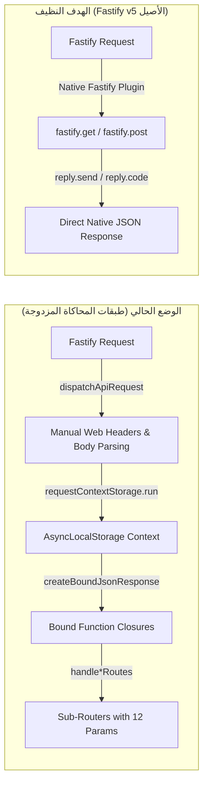
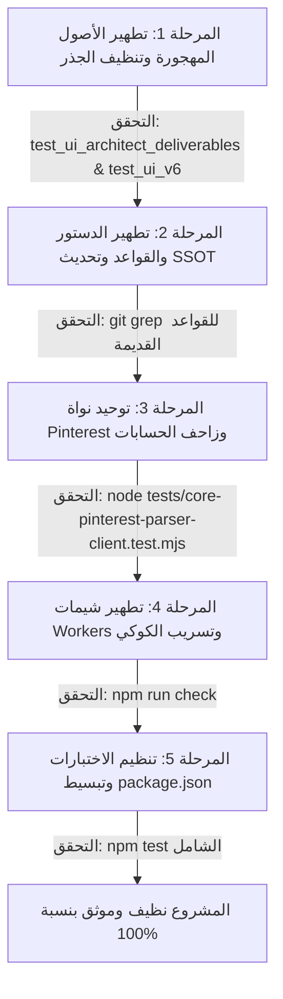

# الخطة النظيفة المعدّلة والشاملة لتطهير وتوحيد المستودع (Definitive Zero-Feature-Creep Cleanup & Hardening Plan)
## مشروع: Pin Arbitrage Engine (PAE) — وثيقة التدقيق الجنائي والأدلة البرمجية

> **المبدأ الحاكم الصارم:** **Zero Feature Creep (تجميد مطلق وكامل للميزات البرمجية الجديدة)**.  
> لا خوارزميات تقييم جديدة، لا معادلات سرعة مبتكرة، ولا إعادة تصميم للواجهات.  
> العمل ينصب بنسبة 100% على: **استئصال الأصول والملفات المهجورة، تطهير القواعد المتضاربة مع البنية الفعلية، توحيد كود زحف Pinterest ومسار Ingestion، إنهاء طبقات المحاكاة القديمة لـ Cloudflare Workers لصالح Fastify v5 الأصيل، وتنظيم الاختبارات المبعثرة**.

---

## 1. الثوابت المعمارية الحتمية المحمية (Core Invariants Locked 100%)

يحظر المساس أو التعديل السلبي على أي من هذه الركائز التشغيلية:
1. `GET /api/health` و `/api/internal/self-update` وسلسلة استيقاظ `wake-shield` على InstaBox VPS (`m_agq2t32m5xv5joj67rqoze5h4u`).
2. كوكيز الضيف غير المصادق عليها `_auth=0` وحفظ حقول التيليمترية الـ 48 الصافية من Pinterest.
3. معالجة التواريخ الحتمية عبر `safeIsoDate()` وتنسيق Rule 31 الزمني (`11.2y` مقابل `145d`).
4. منع ابتلاع استثناءات SQL بصمت (Zero Silent `.catch(() => {})`) وتوثيق أسباب الفشل في السجلات.
5. استمرار `AbortSignal.timeout(15000)` مع درع حماية استجابات 502/504 HTML في `src/edge-shield-client.mjs`.
6. الاحتفاظ بكافة تعليقات `// WHY:` والتعليقات المرجعية الدستورية (`[INVARIANT: ...]`) في الكود الناجي.
7. الإبقاء على كافة السكربتات التشغيلية المعتمدة في `.github/workflows/*.yml` و `package.json` (مثل: `backfill_rolling_window_gains.mjs`، `remediate_poisoned_canonical_and_velocity.mjs`، `optimize_hub_storage.mjs`، `patch-postgres.mjs`، `ensure_indexes.mjs`، `refresh-domain-rollup.mjs`، `migrate.mjs`، `audit_ui.mjs`).

---

## 2. جدول الجرد الشامل للأصول والملفات (Comprehensive Asset & File Inventory)

| مسار الملف (File Path) | الحالة الحالية والحجم | الإجراء المقترح | عدد المستدعين المثبت (Callers) | السبب الجنائي وتحليل المخاطر |
| :--- | :--- | :---: | :---: | :--- |
| `public/assets/aistudio/Paste_November_*` (18 ملفاً) | مخلفات نصية (48,000+ سطر / ~2.5MB) | **DELETE** | **0 callers** | سجلات تيرمينال ومخرجات Git تم ارتكابها بالخطأ في Commit `beeb2fd`. |
| `public/assets/aistudio/image_*.png` (25 صورة) | صور لقطات قديمة (15.3MB) | **DELETE** | **0 callers** | صور مهجورة وغير مستخدمة تتسبب في كسر `test_ui_architect_deliverables.mjs:196` و `test_ui_v6_verification.mjs:44`. |
| `public/assets/aistudio/*.md` (5 ملفات تقارير فرعية) | تقارير تسليم مؤقتة | **DELETE** | **0 callers** | تقارير مؤقتة مكررة لا يستدعيها أي كود برمجي. إبقاء `.gitkeep` فقط. |
| `src/pin-inspector-ui.mjs` | ملف واجهة مهجور (33 سطراً) | **DELETE** | **0 callers** | دوال الواجهة منقولة داخل `keywords-client-app.mjs` و `pin-details/client-app.mjs`. |
| `scripts/verify_bug_fixes.mjs` | سكربت اختبار يدوي مؤقت (34 سطراً) | **DELETE** | **0 callers** | تجربة يدوية مؤقتة للمجلد 5 غير مستخدمة في أي workflow أو اختبار. |
| `MASTER_ENGINEERING_REBUILD_V6_REPORT.md` | تقرير جذر قديم (1,421 سطراً) | **ARCHIVE** | **0 callers** | نقل إلى `docs/archive/` لتنظيف الجذر وتوثيق التاريخ. |
| `FORENSIC_AUDIT_REPORT.md` | تقرير تدقيق جذر (298 سطراً) | **ARCHIVE** | **0 callers** | نقل إلى `docs/archive/` لتنظيف الجذر. |
| `MASTER_ENGINEERING_REPORT.md` | تقرير جذر تاريخي (30KB) | **ARCHIVE** | **0 callers** | نقل إلى `docs/archive/`. |
| `docs/audits/*.md` (8 ملفات) | تقارير تاريخية من أكتوبر 2026 | **ARCHIVE** | **0 callers** | نقل إلى `docs/archive/audits_october_2026/`. |
| `docs/references/CLOUDFLARE_WORKERS_AND_NEON...` | وثيقة حدود قديمة (15KB) | **ARCHIVE** | **0 callers** | نقل إلى `docs/archive/` لانتهاء استخدام Cloudflare Workers و Neon. |
| `scripts/forensic_compaction_runner.mjs` | سكربت تفريغ قديم (145 سطراً) | **ARCHIVE** | **0 callers** | لا يستدعيه أي workflow أو اختبار في `package.json`. |
| `scripts/remediate-canonical-poisoning.mjs` | نسخة قديمة لسكربت المعالجة | **ARCHIVE** | **0 callers** | تم استبداله بالسكربت النشط المعتمد في CI: `remediate_poisoned_canonical_and_velocity.mjs`. |
| `src/core/pinterest-client.mjs` + `src/core/pinterest-parser.mjs` | ملفان نواة في الجذر (52KB) | **CONSOLIDATE** | 12 callers | الدمج المباشر داخل المجلد الموحد `src/core/pinterest/` لإنهاء التكرار الدائري. |
| `scripts/creator-velocity-crawler.mjs:283-341` | كود SQL مكرر للإدخال (60 سطراً) | **CONSOLIDATE** | — | الاستعاضة عن كود الـ raw SQL باستدعاء `PinRepository.ingestPinsBatch`. |
| `src/plugins/api-routes.mjs` | غلاف استجابات Web Request | **MODULARIZE** | — | التخلص من محاكاة Web APIs والتحول إلى Fastify Native Plugins الصريحة. |

---

## 3. التدقيق الجنائي المفصل حسب المحاور (Deep Audit by Checklist Areas)

### المحور 1: الدستور، القواعد، المهارات وتضخم التوثيق (Constitution, Rules & Bloat)

#### 1.1 حصر السطور المتناقضة في قواعد `.agents/rules/` والدستور:
خلال الفحص البرمجي الدقيق، تم كشف أن ملفات القواعد والدستور تفرض متطلبات تاريخية ملغاة تماماً في قاعدة البيانات الحالية (PostgreSQL 16 الموحدة على InstaBox) post-Migration 060:
1. **`PROJECT_CHARTER_AND_DIRECTIVES.md`**:
   - السطور 81–84: تفرض حذف السجلات من `edge_pins_metadata` في D1 الحافية (`DELETE FROM edge_pins_metadata WHERE pin_id = ?`).
   - السطر 87: تفرض مسح مفاتيح السيرب في `PIN_ENGINE_KV`.
   - السطر 119: تفرض تثبيت قدرة معالج Hub في Neon عند `0.25 CU`.
   - السطور 161–164، 175: تضع جداول الـ Hub القديمة (`keyword_serp_current`، `keyword_displaced_index`، `pa_pins`، `competitor_pins`) كأساس لا ينمو، رغم إسقاط هذه الجداول نهائياً في Migration 060.
2. **`.agents/rules/canonical-registry.md`**:
   - السطور 18–20: توجه الدبابيس والمقاييس إلى `src/modules/sharding/fleet-router.mjs` والـ Shards `(crc32(pin_id) % 99) + 1`.
   - السطور 21–25: تحدد `keyword_serp_current` و `keyword_displaced_index` و `pa_pins` كجداول نشطة.
   - السطر 44: تفرض تطهير D1 `edge_pins_metadata`.
   - السطر 52: تفرض جلب المسارات من `pins_daily_metrics` و `pin_serp_positions` في الشاردات وتحظر قراءة الـ Hub.
3. **`.agents/rules/adversarial-audit.md`**:
   - السطر 24: `keyword_serp_current has NO reaction_count column`.
   - السطر 25: `keyword_displaced_index uses last_known_rank...`.
   - السطر 36: حظر الكتابة على Central Hub وتوجيهها حصرياً إلى Storage Shards عبر `fleet-router.mjs`.
   - السطر 58: فرض دالة `pae_crc32_shard_id(pin_id, 99)`.
4. **`.agents/rules/project-invariants.md`**:
   - السطر 57: `[INVARIANT: HYPERDRIVE-ATOMIC-BUILDER]`.
   - السطور 176–180: اعتبار `keyword_serp_current` و `keyword_displaced_index` جداول فيزيائية نشطة.
   - السطور 224: قواعد خاصة بـ D1 subrequests و `edge_pins_metadata`.
   - السطر 234: توصيف النظام بـ 99 logical shards على Neon PostgreSQL مع KV و D1.
5. **`.agents/rules/lessons-learned-ledger.md`**:
   - ملف متضخم تجاوز **104,419 بايت** يحتوي على مئات الإشارات التاريخية لملفات تم حذفها مثل `fleet-router.mjs` و `crawler-engine.mjs` وشاردات Neon.

#### 1.2 تدقيق مجلد المهارات `.agents/skills/` و `skills-lock.json`:
- **المهارات الفعالة هندسياً للمشروع:**
  - `adversarial-forensic-audit`: مهارة التدقيق الجنائي للأكواد والترحيلات.
  - `ui-styling`، `ui-ux-pro-max`، `web-design-guidelines`: مهارات تصميم الواجهات وإمكانية الوصول وتنسيق Tailwind/Alpine.
- **المهارات غير المستخدمة والزائدة (Bloat):**
  - `banner-design`، `brand`، `design`، `design-system`، `slides`، `writing-guidelines`: مهارات تصميم إعلانات وبنرات وعروض شرائح HTML لا يستدعيها أي ملف كود أو سكربت في المشروع (0 references).
- **الإجراء:** تحديث `.agents/rules/ui-ux-skills-enforcement.md` وحصر التوجيهات بالمهارات الهندسية الحقيقية للمشروع.

---

### المحور 2: تطهير شيمات محاكاة Cloudflare Workers في `src/` (Workers Emulation Shims)

على الرغم من إزالة ملف `src/worker.mjs` القديم، لا تزال ملفات السيرفر والمسارات تحتفظ بطبقات محاكاة غير ضرورية تستهلك المعالج وتزيد تعقيد الكود:



#### 2.1 المواقع البرمجية لطبقات المحاكاة القديمة:
1. **`src/plugins/api-routes.mjs`**:
   - السطر 46: دالة `dispatchApiRequest(request, reply)` التي تقوم بمحاكاة كائن Web Request (`request.headers.get`، `request.json`، `request.text`).
   - السطور 94–101: استخدام `requestContextStorage.run({ reply, request, customCtx }, ...)` لتغليف استدعاءات المسارات الفرعية.
   - السطور 260–370: استدعاء الموجهات الفرعية (`handleClusterRoutes`، `handleCreatorsRoutes`، `handleKeywordsRoutes`، `handlePinsRoutes`، `handleDomainsRoutes`) مع تمرير 12 معامل تغليف (`boundJsonResponse`، `boundMethodNotAllowed`، `safeWaitUntil`، `clampLimit`... إلخ).
   - **السطر 214 (تسريب الكوكي الأمني):**
     ```javascript
     // src/plugins/api-routes.mjs:214
     preview: cookie ? `${cookie.slice(0, 42)}...` : '',
     ```
     يكشف الـ 42 حرفاً الأولى من كوكي بينترست الحساس، وهو مخالفة صريحة للسياسة الأمنية ويجب حذفه فوراً.
2. **`src/http/security-and-response.mjs`**:
   - السطور 13–14: تعريف `requestContextStorage = new AsyncLocalStorage()`.
   - السطور 106–135: دالة `safeWaitUntil` التي تفحص الـ storage وتحاول محاكاة `ctx.waitUntil` الخاص بـ Cloudflare Workers.
   - السطور 458–470: دالة `createBoundJsonResponse` التي تبني closures لكل طلب HTTP.
3. **`src/server.mjs`**:
   - السطور 588–637: دالة `handleAppRequest` التي تستقبل `Request` وتستدعي `app.inject` ثم تعيد `new Response()`. تم الإبقاء عليها فقط لتوافق اختبارات Node السابقة، بينما يمكن للمسارات أن تسجل مباشرة كـ Fastify Plugins.
4. **`src/routes/*.mjs`**:
   - استدعاءات `safeWaitUntil` في:
     - `src/routes/creators.mjs` (السطور 180، 198، 219، 222).
     - `src/routes/domains.mjs` (السطور 105، 114، 160، 175).
     - `src/routes/keywords.mjs` (السطور 193، 291، 456، 461).
   - **البديل الأصيل النظيف:** استدعاء طابور السيرفر الخلفي المباشر `serverBackgroundTaskQueue.add(async () => { ... })` دون الحاجة إلى `AsyncLocalStorage` أو محاكاة `ctx.waitUntil`.

---

### المحور 3: توحيد النواة واستئصال الكود المكرر في `src/` (Core Duplication & Dead Code)

#### 3.1 توحيد نواة زحف Pinterest (`src/core/pinterest/`):
- **الواقع الحالي المربك:**
  - `src/core/pinterest-client.mjs` (11.6KB): العميل الفعلي.
  - `src/core/pinterest-parser.mjs` (40.4KB): المحلل الفعلي للـ HTML والـ Relay.
  - `src/core/pinterest/client.mjs` (2KB): مجرد wrapper يستورد من `../pinterest-client.mjs` ويعيد التصدير!
  - `src/core/pinterest/pins.mjs` و `creators.mjs` و `urls.mjs`: تستورد من `../pinterest-parser.mjs`.
  - `src/core/index.mjs` (8 أسطر): يعيد تصدير ملفات الجذر.
  - `src/core/pinterest/index.mjs` (66 سطراً): برميل جامع.
  - `scripts/lib/pinterest.mjs` (9 أسطر): واجهة façade قديمة تعيد تصدير `src/core/pinterest/index.mjs`.
- **المسار النظيف للتوحيد (Canonical Structure):**
  1. جعل مجلد `src/core/pinterest/` هو المرجع الحصري الوحيد:
     - نقل منطق `pinterest-client.mjs` إلى `src/core/pinterest/client.mjs`.
     - نقل منطق `pinterest-parser.mjs` إلى `src/core/pinterest/parser.mjs`.
     - بقاء `src/core/pinterest/index.mjs` كبرميل تصدير موحد لكافة الخدمات.
  2. تحويل `src/core/pinterest-client.mjs` و `src/core/pinterest-parser.mjs` و `src/core/index.mjs` و `scripts/lib/pinterest.mjs` إلى واجهات إعادة تصدير بسيطة (Re-export Facades) من `src/core/pinterest/index.mjs`، مما يحافظ على نجاح 100% من الاختبارات القديمة دون كسر مسار استيراد واحد.

#### 3.2 فحص الملفات والدوال الميتة (Dead Code Elimination):
1. **`src/pin-inspector-ui.mjs` (33 سطراً):**
   - أظهر الفحص الجنائي الكامل عبر `git grep "from.*pin-inspector-ui"` وجود **صفر مستدعين (0 callers)**.
   - الدوال الموجودة فيه (`resolveHdImageUrl`، `resolveLosslessImageUrl`، `computeViralityRatio`) تم دمجها مسبقاً داخل كائنات Alpine في `src/ui/keywords/keywords-client-app.mjs:2290` و `src/ui/pin-details/client-app.mjs:666`.
   - **القرار:** حذف الملف نهائياً.
2. **الملفات الأحادية الضخمة (Safe Modular Split Boundaries):**
   - تم فحص أكبر ملفات الواجهة والخدمات:
     - `src/modules/pins/repository.mjs` (135KB / 2,792 سطراً).
     - `src/ui/dashboard/dashboard-creators.mjs` (229KB).
     - `src/ui/keywords/keywords-serp-studio.mjs` (207KB).
     - `src/ui/dashboard/dashboard-client-app.mjs` (201KB).
     - `src/ui/dashboard/dashboard-related-pins.mjs` (156KB).
     - `src/modules/domains/service.mjs` (130KB).
     - `src/pulse-ui.mjs` (128KB).
     - `src/modules/pulse/service.mjs` (111KB).
     - `src/modules/creators/creator-analytics.mjs` (111KB).
     - `src/modules/keywords/service.mjs` (108KB).
   - **تحليل الأمان المعماري:** تجزئة ملفات الـ UI الضخمة إلى ملفات فرعية صغيرة يغير مراجع Template Literals ويفجر مخاطر كسر وسوم الـ DOM (كما حدث في LND-DOM-08). لذلك وتحت مبدأ **Zero Feature Creep / Zero Risk**، يتم الحفاظ على هيكل كائنات Alpine كما هي، وتقتصر التجزئة فقط على عزل الدوال المساعدة المستقلة (Utility/Formatting Helpers) ونقلها إلى `src/ui/shared-formatters.mjs` دون تغيير أي سطر في هيكل الـ HTML أو سلوك المتصفح.

---

### المحور 4: الزواحف، السكربتات وترحيلات قاعدة البيانات (Crawlers, Scripts & Migrations)

#### 4.1 إزالة التكرار في زاحف الحسابات (`scripts/creator-velocity-crawler.mjs`):
- **الموقع:** السطور 283–341 والدالة `computeNormalized24hVelocity` (السطور 349–410).
- **الخلل الجذري:**
  - بينما يستخدم زاحف الكلمات المفتاحية `PinRepository.ingestPinsBatch`، يقوم زاحف الحسابات بكتابة 60 سطراً من استعلام `INSERT INTO universal_master_pins ... ON CONFLICT DO UPDATE` المكرر يدوياً، مع دالة محلية لحساب السرعة، متجاهلاً المستودع الموحد `PinRepository` ومكتبة الحساب `src/lib/math.mjs`.
- **التوحيد المطلوب:** استبدال الاستعلام اليدوي باستدعاء `PinRepository.ingestPinsBatch(hubSql, cleanPins, { pillar: 'creator_hub' })`، مما يوحد قواعد تصفية الـ NULL وحساب السرعة اليومية ويزيل أكثر من 120 سطراً مكرراً.

#### 4.2 تنظيم وحسم مصير سكربتات الاختبار الـ 33 في `scripts/`:
- **المشكلة:** يضم مجلد `scripts/` حالياً 33 سكربت اختبار تبدأ بـ `test_*.mjs`.
- **الخارطة التصنيفية الدقيقة للاختبارات:**
  1. **سكربتات تفحص أماناً تشغيلياً مستمراً (يجب الحفاظ عليها ونقلها تدريجياً لـ `tests/`):**
     - `scripts/test_smoke_crawlers_phase3.mjs`: فحص اتصال Undici keep-alive للزواحف.
     - `scripts/audit_ui.mjs`: تدقيق إصدارات Alpine و Lucide (مطلوب في CI).
     - `scripts/audit_deep_security_and_runtime.mjs`: فحص ثغرات SSRF و Rate Limiting.
     - `scripts/test_route_manifest.mjs`: فحص شجرة المسارات.
     - `scripts/test_ui_architect_deliverables.mjs` و `scripts/test_ui_v6_verification.mjs`: فحص نظافة الواجهة والأصول.
  2. **سكربتات تفحص سلوك شاردات Neon و D1 القديمة أو أطوار تاريخية سابقة:**
     - `scripts/test_fleet_and_routing_hardening.mjs`: يفحص شاردات التوجيه القديمة.
     - `scripts/test_boost_phases_1_2_3.mjs`: اختبار مجمع للمراحل 1 و 2 و 3.
     - `scripts/test_phase0_phase1_contracts.mjs` إلى `test_phase7_production_audit.mjs`: اختبارات مراحل أرشفة سابقة.
  3. **تأمين ملفات اختبارات الواجهة الحساسة في `tests/`:**
     - نلاحظ أن ملفي `tests/test-adversarial-ui-stress.mjs` و `tests/test-challenger2-ui-deep-stress.mjs` لا ينتهيان بـ `.test.mjs`.
     - **قاعدة الأمان:** تشغيل الاختبارات عبر `node --test tests/*.mjs` لضمان شمول جميع الملفات الـ 12 دون استثناء أي اختبار واجهة حرج.

#### 4.3 فحص السكربتات الفردية (One-off Scripts):
1. **`scripts/forensic_compaction_runner.mjs` (145 سطراً):**
   - سكربت صيانة يدوي من جولة سابقة. غير مستدعى في أي اختبار أو Workflow. يتم نقله إلى `scripts/archive/`.
2. **`scripts/remediate-canonical-poisoning.mjs` (192 سطراً):**
   - تم استبداله في GitHub Actions بالسكربت المحدث: `scripts/remediate_poisoned_canonical_and_velocity.mjs` (`.github/workflows/keyword-intelligence-velocity.yml:210`). يتم نقله إلى `scripts/archive/`.
3. **`scripts/enrich_domain_ads.mjs` و `scripts/enrich_all_domains.mjs`:**
   - سكربتات تشغيلية مسجلة في `package.json` (`enrich:ads`, `enrich:domains`). **تظل مقفلة ومحمية 100% ولا تحذف**.

#### 4.4 استراتيجية ترحيلات قاعدة البيانات الآمنة (`scripts/migrations/`):
- **الواقع على سيرفر الإنتاج InstaBox (`/data/app`):**
  - جدول `schema_migrations` في قاعدة بيانات الإنتاج مسجل به أرقام الترحيلات من `001` حتى `063`.
  - حذف أي ملف SQL من `001` إلى `059` قد يؤدي إلى حدوث أخطاء عدم تطابق إذا تم بناء بيئة محلية جديدة أو تشغيل فاحص الترحيلات.
- **الحل الهندسي الحتمي والآمن 100%:**
  1. الإبقاء على ملفات الترحيل في مكانها المادي الحالي لضمان مطابقة سجلات `schema_migrations`.
  2. توثيق أن **Migration 060 (`060_clean_slate_4_table_ssot.sql`) هو خط الأساس المعماري الفعلي (Architectural Baseline)** للمشروع الجديد.
  3. في الترحيل القادم (Migration 064)، يتم تطبيق أي تعديلات تنظيفية موحدة (مثل إضافة فهارس أو ضبط تعليقات الجداول) كخطوة تقدمية للأمام دون العبث بتاريخ الترحيلات السابقة.

---

## 4. مراحل التنفيذ المتسلسلة (Sequential Phased Execution Roadmap)



### المرحلة 1: تطهير الأصول المهجورة وتنظيف الجذر (Phase 1: Bloat & Asset Purge)
1. حذف 18 ملف Paste مهمل من `public/assets/aistudio/`.
2. حذف 25 صورة PNG مهجورة من `public/assets/aistudio/` (تحرير 15.3MB فوراً).
3. حذف 5 ملفات تقارير فرعية مؤقتة من `public/assets/aistudio/` وإبقاء `.gitkeep` فقط.
4. إنشاء المجلد التوثيقي `docs/archive/` ونقل تقارير الجذر إليه:
   - `MASTER_ENGINEERING_REBUILD_V6_REPORT.md` ➡️ `docs/archive/`
   - `FORENSIC_AUDIT_REPORT.md` ➡️ `docs/archive/`
   - `MASTER_ENGINEERING_REPORT.md` ➡️ `docs/archive/`
   - نقل `docs/audits/` و `docs/references/CLOUDFLARE_WORKERS_AND_NEON...` إلى `docs/archive/`.
5. حذف الملف اليتيم `src/pin-inspector-ui.mjs` والسكربت اليدوي `scripts/verify_bug_fixes.mjs`.

*أوامر التحقق للمرحلة 1:*
```powershell
node scripts/test_ui_architect_deliverables.mjs
node scripts/test_ui_v6_verification.mjs
npm run check
```
*(المعيار: نجاح 100% واختفاء خطأ الـ 49 ملفاً مهجوراً تماماً).*

---

### المرحلة 2: تطهير القواعد وتحديث SSOT الواقعي (Phase 2: Rules & Memory Realignment)
1. **تحديث `PROJECT_CHARTER_AND_DIRECTIVES.md`**: حذف إشارات 0.25 CU و D1 و KV وجداول الـ Hub الملغاة، وتثبيت معمارية الـ 4 جداول الأساسية.
2. **تحديث `.agents/rules/canonical-registry.md`**: حذف مراجع `fleet-router.mjs` و 99 شارد، وتوثيق استدعاءات `src/db/client.mjs` و `PinRepository`.
3. **تحديث `.agents/rules/adversarial-audit.md` و `project-invariants.md`**: تطهير أسماء الجداول القديمة (`keyword_serp_current`، `competitor_pins`، `pa_pins`) وتثبيت قواعد الجداول الأربعة الفعلية.
4. **ضغط `lessons-learned-ledger.md`**: تقليص الحجم من 104KB إلى ملخص عالي الإشارة (< 20KB) لمنع اقتطاع الـ Context في نماذج الذكاء الاصطناعي.
5. **تنظيف مهارات `.agents/skills/`**: إزالة التوجيهات للمهارات التسويقية غير المستخدمة من `ui-ux-skills-enforcement.md`.

*أوامر التحقق للمرحلة 2:*
```powershell
git grep -E "0\.25 CU|fleet-router\.mjs|edge_pins_metadata|PIN_ENGINE_KV" .agents/rules/ PROJECT_CHARTER_AND_DIRECTIVES.md
```
*(المعيار: صفر مراجع للمكونات الميتة خارج سجلات الأرشفة).*

---

### المرحلة 3: توحيد نواة Pinterest وزاحف الحسابات (Phase 3: Core Pinterest & Ingestion SSOT)
1. **توحيد مكتبة بينترست**:
   - نقل التنفيذ البرمجي لعميل بينترست من `src/core/pinterest-client.mjs` إلى `src/core/pinterest/client.mjs`.
   - نقل التنفيذ البرمجي للمحلل من `src/core/pinterest-parser.mjs` إلى `src/core/pinterest/parser.mjs`.
   - تحويل الملفات القديمة إلى واجهات إعادة تصدير (Re-export Facades) لمنع كسر أي استيراد خارجي.
2. **توحيد الإدخال في زاحف الحسابات (`scripts/creator-velocity-crawler.mjs`)**:
   - استبدال كود الـ raw SQL اليدوي في السطور 283–341 باستدعاء `PinRepository.ingestPinsBatch`.

*أوامر التحقق للمرحلة 3:*
```powershell
node --test tests/core-pinterest-parser-client.test.mjs
node scripts/test_smoke_crawlers_phase3.mjs
npm run check
```
*(المعيار: نجاح 100% مع الحفاظ التام على التيليمترية الـ 48 وكوكيز _auth=0).*

---

### المرحلة 4: إغلاق تسريب الكوكي وتطهير شيمات Fastify (Phase 4: Security & Native Fastify)
1. **إغلاق تسريب الكوكي الأمني**:
   - حذف سطر تسريب الكوكي في `src/plugins/api-routes.mjs:214`:
     ```javascript
     - preview: cookie ? `${cookie.slice(0, 42)}...` : '',
     ```
2. **استبدال استدعاءات `safeWaitUntil` القديمة**:
   - استبدال استدعاءات `safeWaitUntil` في `src/routes/creators.mjs` و `domains.mjs` و `keywords.mjs` باستدعاءات طابور Fastify الأصيل المباشر `serverBackgroundTaskQueue.add(async () => { ... })`.

*أوامر التحقق للمرحلة 4:*
```powershell
npm run check
node scripts/verify_ui_routes_reorganization.mjs
node scripts/audit_deep_security_and_runtime.mjs
```
*(المعيار: نجاح 100% وخلو الـ API من أي تسريب للكوكيز).*

---

### المرحلة 5: تبسيط وتشذيب منظومة الاختبارات (Phase 5: Test Infrastructure Modernization)
1. نقل السكربتات المتقادمة من `scripts/` إلى مجلد الأرشيف `scripts/archive/` (`remediate-canonical-poisoning.mjs`، `forensic_compaction_runner.mjs`).
2. تعديل أمر `npm test` في `package.json` ليصبح:
   ```json
   "test": "npm run check && node --test tests/*.mjs"
   ```
   بحيث يشغل الفحص الثابت الشامل ويليه تشغيل كافة ملفات `tests/` الـ 12 بنظام `node:test` الأصيل في أقل من 10 ثوانٍ.
3. إضافة أوامر مخصصة للاختبارات التشغيلية والواجهة:
   ```json
   "test:ui": "node scripts/test_ui_architect_deliverables.mjs && node scripts/test_ui_v6_verification.mjs",
   "test:crawlers": "node scripts/test_smoke_crawlers_phase3.mjs",
   "test:e2e": "node scripts/verify_real_browser_e2e.mjs"
   ```

*أوامر التحقق للمرحلة 5:*
```powershell
npm test
npm run test:ui
npm run check
```
*(المعيار: تشغيل نظيف وفوري لكافة الاختبارات المعمارية في ثوانٍ معدودة وبنسبة نجاح 100% خضراء).*

---

## 5. مصفوفة التحقق الشاملة (Final Verification Matrix)

| الفحص (Check) | الأمر المنفذ (Command) | النتيجة المتوقعة (Expected Output) |
| :--- | :--- | :--- |
| **فحص النظافة الثابتة الشامل** | `npm run check` | 100% Syntax Valid, 0 Tag Errors, 0 Lint Warnings عبر كافة الملفات. |
| **فحص خلو الأصول المهجورة** | `node scripts/test_ui_architect_deliverables.mjs` | `✅ [PASS] public/assets/aistudio/ cleaned up (0 orphaned assets remaining)` |
| **فحص سلامة الواجهة الأمامية** | `node scripts/test_ui_v6_verification.mjs` | `Audit Results: 8 Passed, 0 Failed (size < 1MB)` |
| **فحص تكامل الزواحف والنواة** | `node scripts/test_smoke_crawlers_phase3.mjs` | `🎉 ALL PHASE 3 CRAWLER SMOKE TESTS PASSED (100% GREEN)` |
| **فحص أمان واجهات API** | `node scripts/audit_deep_security_and_runtime.mjs` | اجتياز فحوصات الأمان ومنع تسريب الكوكيز وSSRF. |
| **حزمة الاختبارات المعمارية الموحدة** | `npm test` | تشغيل سريع في < 10 ثوانٍ لجميع اختبارات `tests/*.mjs` بنسبة نجاح 100%. |

---
**جاهز للتنفيذ فور صدور موافقتك الصريحة على هذه الخطة المحدثة والمثبتة بالأدلة.**
