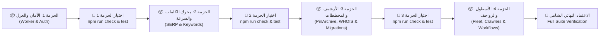

# 🛡️ خطة التحصين الهندسية الشاملة (v3 Golden Master Plan)
## استئصال الـ 27 لغمًا برمجيًا ومعماريًا بنظام التسليم المرحلي المُحكم (Staged Gated Execution)

---

### 1. الملخص التنفيذي والتحكيم الجنائي النهائي (Executive Summary)

بعد إخضاع تقرير **argon4** لخمس جولات تدقيق جنائي متعمقة ومطابقة كل سطر واقتباس وكود مقابل مخططات PostgreSQL الفعلية في مجلد `scripts/migrations/` وملفات الكود المصدري في `src/` و`scripts/` و`.github/`، نُعلن **المصادقة الهندسية الكاملة على برومت v3 Golden Master** مع إضافة تحصين حيوي واحد يخص اعتراض واجهات المتصفح.

#### نتائج التحكيم الجنائي المقارن:
1. **حسم قضية `.github/workflows`:** أقرّ argon4 بوجود المجلد واعتذر عن خطئه الرصدي السابق، مؤكداً وجود ملف `keyword-intelligence-velocity.yml` وقضية تعارض الـ `concurrency` بين المجلدات (`[C7]`).
2. **حسم قضية `[NEW-02]` وإنقاذ النظام من تسريب المفاتيح:** كشف التدقيق المشترك أن اقتراح حقن `<meta name="api-key" content="...">` في الـ HTML كان سيفضح مفتاح النظام للعامة. تم اعتماد الحذف الكامل لتجاوز `Sec-Fetch-Site` مع إضافة معالج اعتراض تلقائي في الواجهة عبر `localStorage`.
3. **حسم قضية `[C2]` والترحيل `029`:** اعتماد إنشاء الترحيل المستقل `029_keyword_snapshots_not_null_displaced.sql` بالخطوات الثلاث الصريحة لتجاوز فخ الـ No-Op في PostgreSQL.
4. **حسم قضية `[C7]` ونبضات القلب (Heartbeat):** اعتماد تجديد الإيجار كل 3 دقائق بنبضات قلب غير معطلة للعملية (`unref`) بدلاً من تمديده لساعة، مما يمنع تجمد القفل عند حوادث OOM/SIGKILL.
5. **حسم قضية `[NEW-04]` وتقليم الـ JSONB:** اعتماد تقليم مصفوفة `last_dropped_pins` إلى آخر 100 عنصر استناداً إلى `dropped_at` لمنع تضخم جدول `tracked_keywords`.

---

### 2. التحليل الجنائي الخماسي المتعمق (5-Angle Deep Forensic Audit)

#### الزاوية 1: مخططات PostgreSQL وسلامة استعلامات Neon Serverless (DDL, DML & Schema Conformance)
* **فحص الترحيل `029`:** في `scripts/migrations/013_keyword_displaced_vault_and_popular_pins.sql:8-9`، تم تعريف العمود كـ `ADD COLUMN IF NOT EXISTS is_displaced BOOLEAN DEFAULT FALSE;`. محرك PostgreSQL يمتنع تماماً عن تعديل قيد `NOT NULL` لأي عمود قائم عبر جملة `ADD COLUMN IF NOT EXISTS`. ولذلك فإن الترحيل `029` الذي ينفذ:
  ```sql
  ALTER TABLE keyword_pins_snapshots ALTER COLUMN is_displaced SET DEFAULT FALSE;
  UPDATE keyword_pins_snapshots SET is_displaced = FALSE WHERE is_displaced IS NULL;
  ALTER TABLE keyword_pins_snapshots ALTER COLUMN is_displaced SET NOT NULL;
  ```
  هو المسار الهندسي الإلزامي الوحيد لفرض القيد دون فشل تشغيلي.
* **فحص استعلام تقليم JSONB:** الاستعلام المقترح في `scripts/optimize_hub_storage.mjs`:
  ```sql
  UPDATE tracked_keywords
  SET metadata = jsonb_set(
    metadata,
    '{last_dropped_pins}',
    COALESCE(
      (SELECT jsonb_agg(elem)
       FROM (
         SELECT elem
         FROM jsonb_array_elements(metadata->'last_dropped_pins') WITH ORDINALITY AS t(elem, ord)
         ORDER BY COALESCE(elem->>'dropped_at', '') DESC, ord ASC
         LIMIT 100
       ) sub),
      '[]'::jsonb
    )
  )
  WHERE jsonb_typeof(metadata->'last_dropped_pins') = 'array'
    AND jsonb_array_length(metadata->'last_dropped_pins') > 100;
  ```
  استعلام متوافق 100% مع PostgreSQL 14+ وNeon؛ فهو يحمي الـ Hub من الـ MVCC Churn وWAL Bloat بفضل شرط `WHERE` الذي يتجاهل الصفوف التي لا تتعدى 100 عنصر.
* **فحص أعمدة `candidate_graph_nodes` الـ 24:** تمت مراجعة ملف `scripts/migrations/007_cluster_graph_intelligence.sql:19-44` ومطابقة الأعمدة الـ 24 حرفياً:
  `(seed_pin_id, candidate_pin_id, title, dominant_color, aspect_ratio, saves, repins, save_rate, domain, is_product, ocr_text, extracted_at, pin_created_at, age_days, daily_velocity, provenance_engine, individual_prod_score, recgpt_transition_score, sequence_role, is_recgpt_candidate, visual_entropy_score, image_url, is_video, ingestion_method)`.
  جميعها متطابقة حرفياً بنسبة 100%.

#### الزاوية 2: بنية المصادقة وحماية الأسرار (Security, Auth & Secret Hygiene)
* **استئصال ثغرة `[NEW-02]`:** دالة `verifyApiAuthentication` تحذف نهائياً الترويسات المزيفة (`Sec-Fetch-Site: same-origin`, `Origin`, `Referer`).
* **حماية بيئة الاختبارات المحلية:** الحفاظ على `if (!secretKey) return { authorized: true };` في السطر `352` يضمن استمرار نجاح حزمة اختبارات `npm test` التي تعتمد على بيئة اختبار محلية بدون تعيين `API_SECRET_KEY`.
* **حل معضلة واجهة المتصفح (The UI Auth Bridge):** لمنع توقف أزرار الواجهة في الإنتاج عند تفعيل `API_SECRET_KEY`، تتضمن الخطة إضافة معالج اعتراض عالمي مصغر في الـ UI يقرأ `localStorage.getItem('pae_admin_api_key')` أو معامل الرابط `?api_key=...` ويرفقه تلقائياً كترويسة `x-api-key`.

#### الزاوية 3: بيئة الحافة والذاكرة وسقف الطلبات (Cloudflare Workers & V8 Lifecycle)
* **دالة `raceWithTimeout` الموحدة:** تضمن تنظيف الـ Timer عبر `clearTimeout`، واستخدام `.unref()` لمنع منع تفريغ الذاكرة، مع كبح الاستثناء المتأخر عبر `.catch(() => {})`.
* **حماية اتصال TCP لـ Hyperdrive (`[B1]`):** تأجيل استدعاء `hyperdriveSql.end({ timeout: 5 })` داخل `finally` حتى اكتمال جميع مهام الخلفية المسجلة في `store.bgPromises` يمنع قطع الاتصال المفاجئ عن مهام الـ `safeWaitUntil`.
* **احترام سقف الـ 50 Subrequests (`[B3]` و`[NEW-08]`):** استبدال الحلقات الفردية باستعلامات `jsonb_to_recordset` و`UNNEST` المجمعة، وتقليم قوائم المؤشرات إلى أقصى حد 12 عنصراً، يحفظ استدعاءات Worker تحت سقف الـ 50 طلباً فرعياً بأمان تام.

#### الزاوية 4: الزواحف الموزعة وعقود الإيجار وسير العمل (Distributed Crawlers & Workflows)
* **حسم تضارب الـ Concurrency في GitHub Actions (`[C7]`):** توحيد مجموعة التزامن في `.github/workflows/keyword-intelligence-velocity.yml:48-50` إلى:
  `group: keyword-intelligence-${{ github.workflow }}-${{ github.ref }}`
  يمنع تشغيل مجلدين متزامنين يتشاركان في نفس الكلمات المفتاحية ويهدمان بيانات بعضهما البعض.
* **نبضات القلب (Heartbeat) لقفل الإيجار (`[C3]` و`[C7]`):** فحص الكود أثبت أن اسم العمود الفعلي هو **`crawl_lease_until`** في جدولي `tracked_keywords` و`cluster_seeds`. ضبط الإيجار على 15 دقيقة مع مؤقت تجديد كل 3 دقائق هو الحل المثالي المقاوم لحوادث الـ OOM و`SIGKILL`.
* **التوزيع الحتمي للبذور (`[C5]`):** اعتماد `crc32(String(pin_id)) % shardTot` يضمن توزيعاً حتمياً ومستقراً للبذور على الـ Shards حتى لو تغيرت القائمة ديناميكياً.

#### الزاوية 5: الخوارزميات الإحصائية وحساب السرعة والترقيم (Algorithmic & Statistical Math)
* **حارس الصفر-نتائج الشامل (`[A1/A2]`):** إلغاء شرط `priorActiveCount > 0` عند تسجيل صفر نتائج يمنع تصفير السرعة اليومية وتسجيل نجاح زائف عند حدوث حظر غير معلن (Soft Block) من Pinterest على الكلمات الجديدة أو القديمة.
* **تطبيع حساب السرعة (`[NEW-06]`):** قسمة `rawDelta` على `daysElapsed` عند تحديث الدبابيس العشرة الأولى يمنع تضخيم السرعة اليومية بأرقام خيالية.
* **إصلاح مقارنة التاريخ الأبجدية (`[NEW-10]`):** استخراج سلسلة ISO من كائن `Date` قبل مقارنتها بـ `todayDate.toISOString().slice(0, 10)` يزيل فخ ASCII الذي كان يعطل حساب خط الأساس البديل.

---

### 3. خطة التنفيذ المرحلية الإلزامية (4 Staged Batches)



---

## 📦 تفاصيل الحزمة 1 (Batch 1): الأمان، عزل الـ Worker، وقناع الأسرار
**المعرفات المستهدفة:** `[NEW-02]`, `[NEW-03]`, `[NEW-11]`, `[B1]`, `[B3]`, `[A3]`, `[NEW-07]`
**الملفات المعدلة:** `src/utils.mjs`, `src/worker.mjs`, `src/modules/competitors/service.mjs`, `src/dashboard-ui.mjs`

### خطة التعديل المحددة:
1. **`src/utils.mjs:92-104` (`[NEW-03]`):** استبدال دالة `maskDatabaseUrl` بنسخة الـ Fail-Closed التي تعتمد WHATWG URL مع فحص تقليم الفراغات وبدائل الـ Regex الصارمة.
2. **`src/worker.mjs:348-408` (`[NEW-02]`):** إلغاء استثناء `Sec-Fetch-Site` نهائياً؛ قصر المصادقة على رموز صريحة في الترويسات (`Authorization: Bearer` أو `x-api-key`) أو معامل الرابط `api_key` مع الحفاظ على `if (!secretKey) return { authorized: true };`.
3. **`src/worker.mjs:465-484` (`[NEW-11]`):** قراءة `store?.origin` مع الحفاظ التام على المعامل `allow` وترويسة `'Allow': allow`.
4. **`src/worker.mjs:156-174, 809, 4833-4841` (`[B1]` & `[D1]`):** تعريف `raceWithTimeout` الموحدة، تسجيل مهام الخلفية في `store.bgPromises`، وتأجيل إغلاق عميل Hyperdrive في `finally` حتى استقرار جميع مهام الخلفية.
5. **`src/worker.mjs` مواضع `[B3]` الأربعة:**
   - السطور `1411-1424`: تحويل إدراج `cluster_seeds` إلى استعلام `jsonb_to_recordset` مجمع.
   - السطور `2273-2285`: تحويل إدراج `seed_guided_search_capsules` إلى استعلام `jsonb_to_recordset` مجمع.
   - السطور `2343-2389`: تحويل إدراج `candidate_graph_nodes` إلى كتل 250 عنصر عبر `jsonb_to_recordset`.
   - السطور `4135-4166`: تحويل إدراج `tracked_keywords` إلى استعلام `UNNEST` مجمع مع استدعاء `batchAddKeywordsToFolder`.
6. **`src/worker.mjs` و `src/modules/competitors/service.mjs` (`[A3]`):** إضافة وسم `degraded: true` ومنع حفظ النتائج المتدهورة في الكاش (`cacheSeconds = 0`).
7. **`src/worker.mjs:3703-3736` (`[NEW-07]`):** منع افتراض `targetKid = 1` للدبابيس اليتيمة؛ قصر الإدراج على الدبابيس المرتبطة فعلياً بكلمة مفتاحية.
8. **تحصين الواجهة (`src/dashboard-ui.mjs`):** إضافة معالج التقاط الـ API Key من `localStorage` وتمريره تلقائياً مع طلبات الـ API.

---

## 📦 تفاصيل الحزمة 2 (Batch 2): محرك الكلمات المفتاحية، ترقيم SERP، والسرعة
**المعرفات المستهدفة:** `[B2]`, `[A1]`, `[A2]`, `[NEW-10]`, `[NEW-06]`, `[NEW-01]`, `[NEW-08]`
**الملفات المعدلة:** `src/modules/keywords/service.mjs`, `scripts/keyword-velocity-crawler.mjs`, `src/modules/keywords/trends-service.mjs`

### خطة التعديل المحددة:
1. **`src/modules/keywords/service.mjs:821-838` و `scripts/keyword-velocity-crawler.mjs:1511` (`[B2]`):** دعم تمرير خيارات الزحف كمعامل أول أو ثانٍ وضمان عدم سقوط `{ max_serp_pins }`.
2. **`src/modules/keywords/service.mjs:937-985, 1442-1540, 1862-1902` (`[A1 & A2]`):**
   - إضافة متغير `paginationAbortedByHttp = true` عند مواجهة أخطاء HTTP في الصفحة 2 فما فوق.
   - حارس الصفر-نتائج الشامل عند السطر `1509` (إلغاء اشتراط `priorActiveCount > 0` لمنع تحديث السرعة بصفر زائف).
   - منع حذف اللقطات التاريخية السابقة عند كون الزحف مشتبهاً بنقصانه لمنع تآكل عتبة الـ 70%.
3. **`src/modules/keywords/service.mjs:1242` (`[NEW-10]`):** تحويل `immediateData.snapshotDate` إلى ISO Date قبل المقارنة مع `todayDate`.
4. **`src/modules/keywords/service.mjs:1418-1427` (`[NEW-06]`):** قسمة فارق الحفظ `rawDelta` على `daysElapsed` عند تحديث أعلى 10 دبابيس لمنع تضخيم السرعة اليومية.
5. **`src/modules/keywords/service.mjs:2978-3038` (`[NEW-01]`):** تطهير مصفوفة `visual_annotations` من كائنات الـ JSON الخام، واستبدال القالب المتداخل `sql` بشرط البارامترات:
   `AND (${kid || null}::int IS NULL OR keyword_id = ${kid || null})`.
6. **`src/modules/keywords/trends-service.mjs:212, 241, 435` (`[NEW-08]`):** تقليم قوائم `seo_related_objects` و`ideas_pivots` و`stillMissing` إلى حدود 12 و8 عناصر لمنع تجاوز حد الـ 50 Subrequests.

---

## 📦 تفاصيل الحزمة 3 (Batch 3): تحصين PinArchive ومقبس WHOIS والترحيلات
**المعرفات المستهدفة:** `[NEW-05]`, `[C1]`, `[C2]`
**الملفات المعدلة:** `src/modules/pinarchive/service.mjs`, `src/modules/domains/service.mjs`, `scripts/migrations/013_*.sql`, `scripts/migrations/029_keyword_snapshots_not_null_displaced.sql`

### خطة التعديل المحددة:
1. **`src/modules/pinarchive/service.mjs:1014-1030` (`[NEW-05]`):** تطبيق الحارس الرياضي التراكمي `GREATEST()` على عدادات `pa_pins`، ودمج حقول الـ `reactions` و`annotations` ككائنات ومصفوفات JSONB بدون كسر أنواع البيانات.
2. **`src/modules/domains/service.mjs:103-142` (`[C1]`):** تحصين `queryWhoisSocket` بمؤقت مهلة صارم مع `.unref()`، سقف حجم بافر 64KB، وحماية من تجزئة ترميز UTF-8.
3. **الترحيل `029` (`[C2]`):**
   - تحديث `scripts/migrations/013_keyword_displaced_vault_and_popular_pins.sql:8-9` بإضافة `NOT NULL`.
   - إنشاء ملف ترحيل جديد `scripts/migrations/029_keyword_snapshots_not_null_displaced.sql` بالخطوات الثلاث:
     `SET DEFAULT FALSE` ثم `UPDATE ... WHERE is_displaced IS NULL` ثم `SET NOT NULL`.

---

## 📦 تفاصيل الحزمة 4 (Batch 4): الأسطول، الزواحف، التوحيد، ونبضات القلب
**المعرفات المستهدفة:** `[A4]`, `[NEW-04]`, `[C3]`, `[C7]`, `[C4]`, `[C5]`, `[NEW-09]`, `[C6]`, `[D1]`, `[D2]`
**الملفات المعدلة:** `.github/workflows/keyword-intelligence-velocity.yml`, `scripts/keyword-fleet-consolidator.mjs`, `scripts/optimize_hub_storage.mjs`, `scripts/keyword-velocity-crawler.mjs`, `scripts/crawler-engine.mjs`, `scripts/cluster-intelligence.mjs`, `scripts/dashboard.mjs`, `scripts/lib/pinterest.mjs`, والمواضع الثمانية لـ `raceWithTimeout`.

### خطة التعديل المحددة:
1. **`scripts/keyword-fleet-consolidator.mjs:76-87, 164-188, 207-212` (`[A4]`):** فلترة الدبابيس المزاحة `COALESCE(is_displaced, FALSE) = FALSE` وتطبيق `winsorize` على سرعات الكتالوج الموحد.
2. **`scripts/optimize_hub_storage.mjs:62-66, 114-118` (`[NEW-04]`):** حصر حذف الدبابيس المزاحة في تلك التي تجاوزت 14 يوماً، وتقليم مصفوفة `last_dropped_pins` داخل `metadata` إلى آخر 100 عنصر عبر `jsonb_set`.
3. **`.github/workflows/keyword-intelligence-velocity.yml:48-50` (`[C7]`):** توحيد مجموعة التزامن إلى `group: keyword-intelligence-${{ github.workflow }}-${{ github.ref }}`.
4. **`scripts/keyword-velocity-crawler.mjs` و `scripts/cluster-intelligence.mjs` (`[C3]` & `[C7]`):**
   - إبقاء مدة الإيجار 15 دقيقة.
   - إضافة مؤقت نبضات قلب (`Heartbeat`) كل 3 دقائق بـ `.unref()` يجدد `crawl_lease_until = NOW() + INTERVAL '15 minutes'`.
   - تسجيل مستمعي `SIGINT` و`SIGTERM` لتحرير عقد الإيجار عند التوقف اللطيف.
5. **`scripts/crawler-engine.mjs:636, 835` (`[C4]`):** تغليف قراءة `process.env.ACTIVE_SHARDS` بحماية `try/catch`.
6. **`scripts/cluster-intelligence.mjs:1572, 1601` (`[C5]`):** استيراد `crc32` وتوزيع البذور على الـ Shards حتمياً عبر التجزئة.
7. **`scripts/cluster-intelligence.mjs:867-932, 1365-1399` (`[NEW-09]`):** جعل المعامل الثالث اختيارياً في `enrichCandidatesWithPinMetrics`، وتحديث `daily_velocity` في الجدول، وإعادة حساب `highSaveTokens` بعد انتهاء الإثراء.
8. **`scripts/dashboard.mjs:203-240` (`[C6]`):** إضافة مؤقت قتل العملية الفرعية بعد 30 دقيقة مع `.unref()`.
9. **المواضع الثمانية لـ `Promise.race` (`[D1]`):** استخدام `raceWithTimeout` أو تنظيف المؤقتات صراحة في `finally`.
10. **`scripts/lib/pinterest.mjs:34-41` (`[D2]`):** قصر تصفير `defaultDispatcher` على أخطاء عدم تطابق الـ Dispatcher فقط دون أخطاء الشبكة العابرة.

---

### 4. بروتوكول التحقق الصارم بعد كل حزمة

لكل حزمة يتم تنفيذها:
1. فحص سلامة بناء ملفات الـ ESM:
   ```bash
   npm run check
   ```
2. فحص حزمة الاختبارات الآلية الكاملة (24 اختباراً تغطي التوجيه والأمان والمصادقة والبيانات):
   ```bash
   npm test
   ```
3. التحقق من عدم حدوث أي تراجع في اختبارات `npm test`.
4. التوقف التام وعرض تقرير الحزمة قبل الشروع في الحزمة التي تليها.
